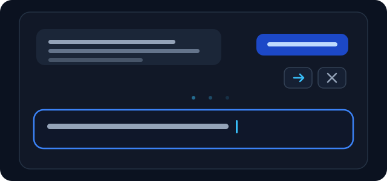

# NextLine

English | [简体中文](README.md)

**The next line, in your own voice.** Personalized next-message suggestions for [DeepSeek Harness](https://github.com/deepseek-ai/deepseek-harness) (DSH).



`v0.1.0` · DSH `0.2.2-rc.2`–`0.3.0` · Desktop / Web

## Features

- A pale suggestion appears in the empty composer after a completed reply.
- **Tab** / **→** accepts it as an editable draft; **Esc** dismisses it.
- Hidden while typing, composing with an IME, or when attachments, queued messages, or a running turn exist.
- Uses DSH theme tokens for the ghost text.

## Install

Requires DSH Desktop / Web `0.2.2-rc.2` through `0.3.0` (exclusive). The terminal TUI is not supported.

From GitHub:

```powershell
dsh plugin --profile desktop add "github:Basspoom/dsh-nextline#v0.1.0"
```

Or open **Plugins → Add plugin** and enter:

```text
github:Basspoom/dsh-nextline#v0.1.0
```

From a local checkout:

```powershell
npm install
dsh plugin --profile desktop add "<path-to-NextLine>"
```

A link install does not install dependencies; `npm install` provides `zod` and `@deepseek-ai/schemastery`. Restart DSH or reload the plugin after changing `src/`.

Enable it under **Settings → Plugins**. Uninstall with:

```powershell
dsh plugin --profile desktop remove dsh-nextline
```

## Usage

Finish a turn, empty the composer, then press **Tab** or **→** to accept a suggestion, or **Esc** to dismiss it. Suggestions appear only when the session is idle and the latest message is assistant text.

## Configuration

Change it under **Settings → Plugins → NextLine**, or add to the profile's `cordis.patch.yml`:

```yaml
- id: nextline
  config:
    enabled: true
    historyEnabled: true
    historyDays: 30
    historySessionLimit: 10
    timeoutMs: 15000
    maxSuggestionChars: 240
    provider: ''
    model: ''
```

`historyEnabled: false` uses only the current conversation; `enabled: false` stops generation. Set `provider` and `model` together to use another route; no API key is stored.

At most one extra request per completed turn, 192 output tokens, 15-second total timeout; cross-session history is capped at 1.5 seconds and prefers recent sessions.

## Privacy and cost

- Selected text from the current conversation and recent history is sent to the current model provider.
- No external service, stored credentials, or training; history stays in host memory.
- Suggestions are recorded as `plugin:nextline/suggestion` in the session log, not in normal model messages.
- For sensitive conversations, disable `historyEnabled` or the plugin. Typing hides a suggestion, but an in-flight request may still incur cost.

## Compatibility

Verified on DSH `0.2.2-rc.2`; `engines.dsh` is `>=0.2.2-rc.2 <0.3.0`. If a DSH upgrade changes the composer API, the suggestion UI may disable itself; chat is unaffected.

## Development

```powershell
npm run build
npm test
npm pack --dry-run
```

`lib/client.js` is generated by `npm run build`; commit it with `src/client.js`. See [CONTRIBUTING.md](CONTRIBUTING.md) for checks, [RELEASING.md](RELEASING.md) for publishing, and [SECURITY.md](SECURITY.md) for reporting.

## License

MIT, see [LICENSE](LICENSE). NextLine is not an official DeepSeek plugin.
